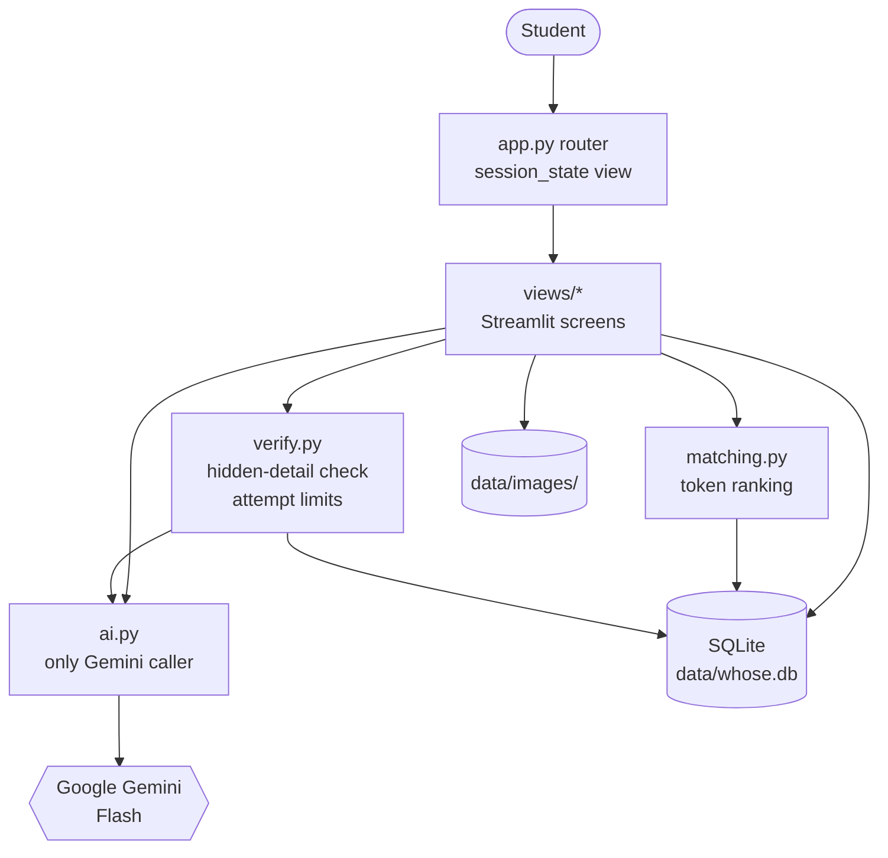
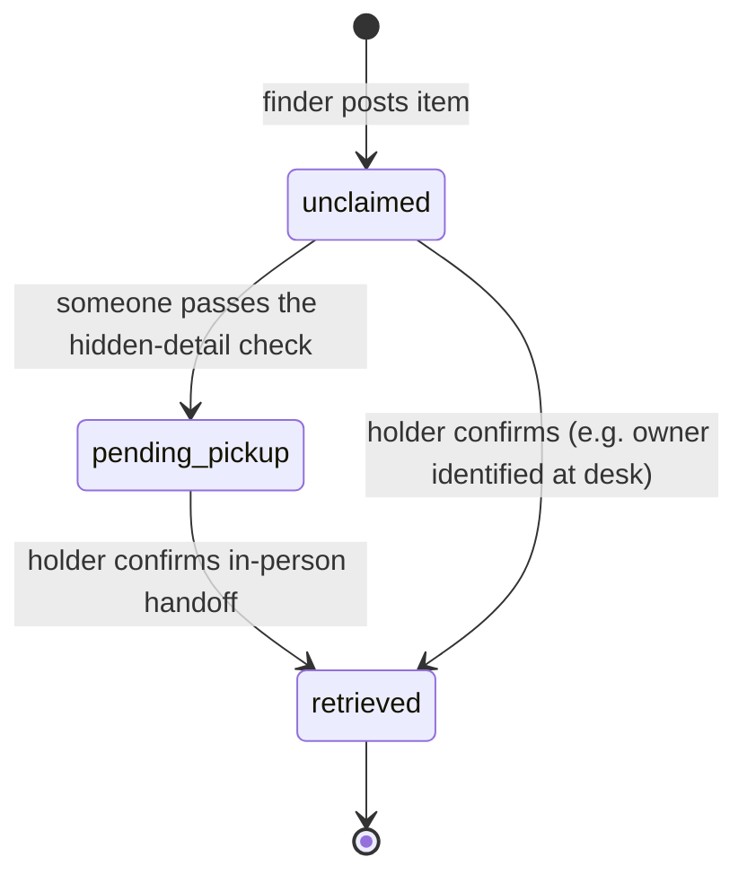

# Whose?

A peer-to-peer lost-and-found app for UT Dallas students.

Live app: https://whose-lost-and-found.streamlit.app/

## Project overview

### The problem

Lost items on a university campus end up scattered across building front desks and group
chats. There is no single place to search, students do not know who to contact about a
particular item, and posting a photo publicly lets anyone claim something that is not theirs.

### Target users

- Finders: students who picked up an item and want to return it.
- Owners: students who lost something and want to find it quickly.
- Lost and Found desk staff: people at campus desks who hold items and confirm pickups.

### Key features

- A finder posts a photo, says who is holding the item (a campus desk or themselves), and
  records a hidden detail only the real owner would know.
- Gemini describes and tags the photo, then flags sensitive items (IDs, cards, wallets,
  phones, documents) and high-value items (laptops, phones, cameras) automatically.
- An owner searches in plain words and gets ranked matches, each with the contact or desk
  to go to. Results are split into claimable items and already-retrieved items.
- To start a claim, the owner answers the hidden detail. The AI judges the answer
  semantically, so different wording still passes.
- Passing verification earns the right to pick the item up in person, not ownership. The
  holder checks a student ID (plus proof of purchase or a serial number for high-value
  items) before marking it retrieved.
- A passcode-protected desk view lists pending pickups and lets staff mark items retrieved
  or archive them. A finder who kept an item marks it retrieved with a one-time handoff code.

## Setup and running locally

### Prerequisites

- Python 3.11
- A Google Gemini API key ([Google AI Studio](https://aistudio.google.com/app/apikey))

### Steps

1. Create and activate a virtual environment:

   ```bash
   python -m venv .venv
   # Windows (PowerShell)
   .venv\Scripts\Activate.ps1
   # macOS / Linux
   source .venv/bin/activate
   ```

2. Install dependencies:

   ```bash
   pip install -r requirements.txt
   ```

3. Provide secrets. Copy the example and fill in your values:

   ```bash
   # Windows (PowerShell)
   Copy-Item .streamlit\secrets.toml.example .streamlit\secrets.toml
   # macOS / Linux
   cp .streamlit/secrets.toml.example .streamlit/secrets.toml
   ```

   Then edit `.streamlit/secrets.toml` so it looks like this (placeholder values shown):

   ```toml
   GEMINI_API_KEY = "your-gemini-api-key-here"
   DESK_PASSCODE = "choose-a-desk-passcode"

   # Optional, defaults to false. When true, the verification form also accepts
   # @gmail.com addresses so the flow can be demonstrated without a real UTD account,
   # and demo notices appear in the UI. Leave false for the live app.
   DEMO_MODE = false
   ```

   All three values can also be supplied as environment variables of the same name instead
   of the file. `.streamlit/secrets.toml` and `.env` are gitignored and must never be
   committed.

4. To confirm your Gemini key works, run `python scripts/check_gemini.py`.

5. Run the app:

   ```bash
   streamlit run app.py
   ```

   The SQLite database at `data/whose.db` is created and seeded with demo items
   automatically on first launch, and whenever the database is empty, so the app looks
   populated without manual setup.

### Tests

Business logic lives in `whose/` and is tested without Streamlit:

```bash
pytest
```

## Deploying to Streamlit Community Cloud

1. Push this repository to GitHub.
2. At [share.streamlit.io](https://share.streamlit.io), create a new app pointing at your
   repository, branch, and `app.py` as the entry point.
3. Open the app's Settings, go to Secrets, and paste the same keys you use locally:

   ```toml
   GEMINI_API_KEY = "your-gemini-api-key-here"
   DESK_PASSCODE = "choose-a-desk-passcode"
   DEMO_MODE = true
   ```

   `DEMO_MODE = true` is useful for a public demo because it lets reviewers verify with a
   Gmail address. Set it to `false` for a real deployment that should require UTD email.
4. Deploy. The runtime installs `requirements.txt` automatically.

Community Cloud storage is ephemeral: the container's local disk, including `data/whose.db`
and uploaded images under `data/images/`, is wiped on restart or redeploy. The app handles
this by reseeding demo items whenever it starts with an empty database, so the deployed app
always has something to search. Treat uploaded data there as disposable.

## Architecture

### Module layout

```
app.py                 # entry point: page config, init db, seed, route by session_state["view"]
whose/
  config.py            # pickup locations, email domains, attempt limits, secrets accessors
  db.py                # sqlite connection, schema, CRUD (hidden detail isolated)
  ai.py                # the only module that talks to Gemini
  matching.py          # rank items against a lost-item description, split by status
  verify.py            # hidden-detail check, attempt limits, status changes
  seed.py              # demo items, inserted on startup if the db is empty
  views/
    home.py            # "I found something" / "I lost something" / desk link
    found.py           # post a found item (AI describe runs here on form submit)
    found_confirm.py   # confirm AI result, handoff code for self-kept items
    lost.py            # search with 5 / 10 / 15 selector, two ranked result sections
    item.py            # item detail, verification form, pickup instructions
    desk.py            # passcode-protected desk view: pending list, mark retrieved, archive
    handoff.py         # finder enters handoff code to mark retrieved
    _ui.py             # shared UI helpers
data/
  images/              # uploaded images (gitignored)
  seed_images/         # images for demo items (committed)
  whose.db             # SQLite database (gitignored, created on first run)
tests/
  test_verify.py
  test_matching.py
```

Streamlit reruns the whole script on every interaction, so the layers are kept strict:
`app.py` only configures the page, runs a cached one-time startup, and routes to a view by
`session_state["view"]`. Each view owns one screen. All AI calls happen inside form submit
handlers, never at the top level. Business logic lives in `whose/` modules with no Streamlit
imports, which is what makes `matching.py` and `verify.py` testable without the app.

### System diagram



### Item lifecycle



- unclaimed: posted, nobody has passed verification yet.
- pending_pickup: at least one person passed the hidden-detail check and was told where to
  go and what to bring. The item stays visible and claimable, because the in-person check is
  what actually decides who gets it.
- retrieved: the holder confirmed the in-person handoff, either desk staff in the desk view,
  or the finder entering their one-time handoff code.

## Design decisions

### Streamlit instead of a full stack

A single Streamlit app covers the whole loop: upload, AI call, database, and rendering in one
Python process. For a hackathon build focused on one core loop, that removes a separate
frontend, API layer, and build step. The cost is Streamlit's rerun-on-every-interaction
model, which the code works around by keeping navigation and UI state in `session_state`,
calling the AI only inside form handlers, writing AI results to the database immediately, and
caching the Gemini client with `st.cache_resource`.

### Token matching with AI-generated synonym tags instead of AI search

Ranking is deterministic token overlap in `matching.py`, not an AI call at search time. When a
finder posts an item, the AI generates 10 to 15 tags that deliberately include everyday
synonyms (a Hydro Flask gets "water bottle", "flask", "tumbler", "bottle", plus color and
material). Search then matches the owner's words against each item's public description and
those tags, with a small boost for location overlap and a larger boost when the query names the
item's primary type. This keeps search instant and free, avoids a Gemini call on every
keystroke-driven rerun, stays within the free tier, and makes ranking reproducible and unit
testable. The AI is used once, up front, where its language knowledge adds the most value.

### SQLite via the standard library

The data is small and single-node, so `sqlite3` from the standard library is enough. There is
no server to run or dependency to add, the schema lives in `db.py`, and a file at
`data/whose.db` is trivial to inspect. On Community Cloud the file is ephemeral, which the seed
step handles by reloading demo data on an empty database.

### Gemini free tier

All model calls go through `ai.py` using the official `google-genai` SDK against a Flash model
with image input. Flash is fast and cheap, and the usage pattern (one describe call per posted
item, one judge call per verification attempt) stays inside the free tier. Every call is wrapped
so a failure shows a friendly message instead of crashing, and 429 / RESOURCE_EXHAUSTED (plus
server stalls and timeouts) maps to a dedicated rate-limit error that tells the user to try
again in a minute.

### Security

- Hidden-detail isolation. The hidden detail is never shown to anyone and never sent to the AI
  describe prompt or included in ranking data. In `db.py` every read used for display, search,
  or AI selects an explicit public column list that omits `hidden_detail`; a single
  `get_hidden_detail` helper is the only read that returns it, used solely by `verify.py`.
- Prompt-injection hardening. During verification the claimant's answer is untrusted input. It
  is fenced between explicit markers in the judge prompt, and the model is instructed to treat
  anything between them strictly as an answer to compare and never as instructions. The result
  check is fail-closed: the entire trimmed response must equal "MATCH", so a response like
  "NO_MATCH" (which contains "MATCH") never passes via a substring check.
- Attempt limits. Each email gets a limited number of attempts per item
  (`MAX_ATTEMPTS_PER_EMAIL`), after which that email is locked for that item. A separate
  per-item cap (`ITEM_REVIEW_CAP`) flags an item for desk review once total failed attempts
  across everyone reach it. Attempts are recorded only on a genuine wrong answer: a failed AI
  call or rate limit never counts against the user.
- Sensitive item photos. Items the AI flags as sensitive (IDs, payment cards, wallets, phones
  showing a lock screen, documents) are listed with a generic description and no photo until a
  claimant passes verification, so the public listing cannot leak identifying details.
- Demo mode. `DEMO_MODE` only widens the accepted email domains to include Gmail and toggles
  demo notices. It never relaxes the hidden-detail check, attempt limits, or sensitive-item
  handling. Allowed domains live in `config.py`, not hardcoded in views.
- Secrets. `GEMINI_API_KEY` and `DESK_PASSCODE` come from `st.secrets` or environment
  variables and are never hardcoded. Handoff codes are generated with `secrets.choice` from an
  alphabet that excludes ambiguous characters, and are shown once.

## Kiro Usage

<!-- TODO: write this section. -->

## Learning Journey

<!-- TODO: write this section. -->

## Out of scope (future work)

Real UTD login, notifications, in-app messaging, maps, and automatic semester-end deletion of
retrieved items.
